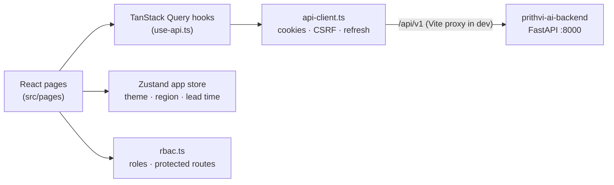

<div align="center">

# PRITHVI-AI · Nexus (console prototype)

### Early React console for the PRITHVI-AI climate-health early-warning platform

[](https://react.dev/)
[](https://vitejs.dev/)
[](https://www.typescriptlang.org/)
[](https://ui.shadcn.com/)
[](LICENSE)
[](https://github.com/rupeshbharambe24/prithvi-ai-frontend)

</div>

> [!IMPORTANT]
> **Superseded by [`prithvi-ai-frontend`](https://github.com/rupeshbharambe24/prithvi-ai-frontend).**
> This repository is the original console codebase: it was scaffolded with Lovable in
> November 2025 and then wired to the real [FastAPI backend](https://github.com/rupeshbharambe24/prithvi-ai-backend)
> in March 2026. Development then continued in `prithvi-ai-frontend`, which shares this exact
> commit history and adds the **Models** catalog page and a mock-free **Fairness** page.
> It is kept for reference only.

## Overview

PRITHVI-AI forecasts climate-driven health risks (heat stress, dengue-type disease, hospital
ED surge and PM2.5) per region, with uncertainty bands, evidence and alerts. This repo is the
operator console for that platform: a role-protected single-page app that calls the backend's
`/api/v1` REST API through a small fetch wrapper (cookie auth, CSRF header, automatic token
refresh and `X-Request-ID` tracing).

### Highlights

- Cookie + CSRF authentication with a refresh-and-retry fetch wrapper (`src/lib/api-client.ts`)
- Five roles (`OrgAdmin`, `Epidemiologist`, `HospitalOps`, `FieldOfficer`, `Viewer`) and protected routes (`src/lib/rbac.ts`)
- Risk dashboards for heat, disease, hospital surge and air quality backed by TanStack Query hooks (`src/hooks/use-api.ts`)
- Knowledge-graph explorer (Cytoscape), evidence browser, dataset catalog with lineage
- Scenario runner, fairness / drift reports and alert rules + acknowledgement
- Light / dark / system theme (Zustand store) and English / Hindi strings (i18next)

## Screens and routes

| Route | Screen | Access |
|-------|--------|--------|
| `/` | Landing page | public |
| `/status` | Backend status check | public |
| `/auth/login`, `/auth/signup` | Login / sign-up | public |
| `/profile` | User profile | signed in |
| `/console/overview` | Overview of all risk targets | signed in |
| `/console/heat` | Heat risk | signed in |
| `/console/disease` | Disease risk | signed in |
| `/console/hospital` | Hospital surge | signed in |
| `/console/air` | Air quality (PM2.5) | signed in |
| `/console/scenario` | Scenario planner | signed in |
| `/console/kg` | Knowledge graph explorer | signed in |
| `/console/evidence` | Evidence list | signed in |
| `/console/catalog` | Dataset catalog + lineage | signed in |
| `/console/fairness` | Fairness and drift (falls back to sample data when no report exists) | signed in |
| `/console/alerts` | Alerts and alert rules | signed in |
| `/console/settings` | Settings | signed in |

## Architecture



## Tech stack

| Area | Libraries |
|------|-----------|
| Framework | React 18, TypeScript 5, Vite 5 (SWC) |
| UI | Tailwind CSS, shadcn/ui (Radix), lucide-react, Framer Motion |
| Data | TanStack Query, TanStack Table, Zustand |
| Visualisation | Recharts (time series, p05/p95 bands), Cytoscape (knowledge graph) |
| Forms / i18n | react-hook-form + zod, i18next |

## Getting started

Prerequisites: Node.js 18+, and the [backend](https://github.com/rupeshbharambe24/prithvi-ai-backend) running on port 8000.

```bash
npm install
cp .env.example .env.local   # VITE_API_PREFIX=/api/v1, empty base URL uses the dev proxy
npm run dev                  # http://localhost:5173 (proxies /api -> http://localhost:8000)
```

Other scripts: `npm run build`, `npm run preview`, `npm run lint`.

The backend seeds a demo account (`admin@example.com` / `Admin123!`) in local mode.

## Project structure

```text
prithvi-nexus/
├── public/                 robots.txt
├── src/
│   ├── pages/
│   │   ├── console/        Overview, HeatRisk, DiseaseRisk, HospitalSurge, AirQuality,
│   │   │                   Scenario, KnowledgeGraph, Evidence, Catalog, Fairness,
│   │   │                   Alerts, Settings, Layout
│   │   ├── auth/           Login, Signup
│   │   └── Landing, Status, Profile, NotFound
│   ├── components/
│   │   ├── console/        ConsoleSidebar, ConsoleTopbar, RegionPicker, DateLeadPicker
│   │   └── ui/             shadcn/ui primitives
│   ├── hooks/              use-api (query/mutation hooks), use-toast, use-mobile
│   ├── lib/                api-client, rbac, i18n, utils
│   └── store/              appStore (Zustand)
├── .env.example
├── vite.config.ts          dev server :5173, /api proxy, lovable-tagger in dev mode
└── package.json
```

## Related repositories

| Repository | Role |
|------------|------|
| [`prithvi-ai`](https://github.com/rupeshbharambe24/prithvi-ai) | Umbrella repo (backend + frontend as submodules) |
| [`prithvi-ai-backend`](https://github.com/rupeshbharambe24/prithvi-ai-backend) | FastAPI + XGBoost backend, data pipelines, continuous ML loop |
| [`prithvi-ai-frontend`](https://github.com/rupeshbharambe24/prithvi-ai-frontend) | Current console (successor of this repo) |
| **`prithvi-nexus`** | This repo: earlier console snapshot |

## License

[MIT](LICENSE) © 2025 Rupesh Bharambe
